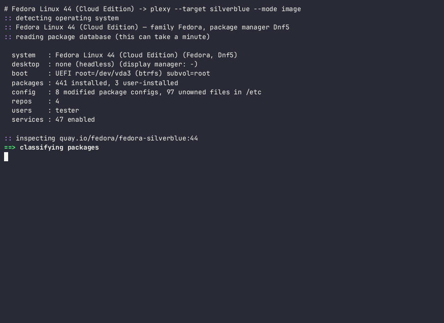
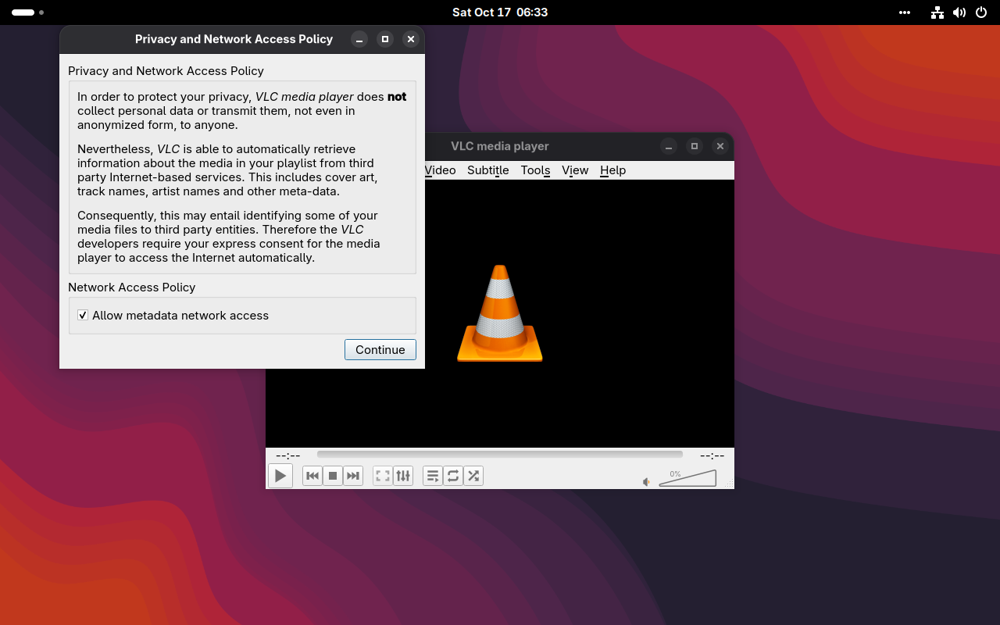

# Plexy

**Turn the Linux you already have into an image-based ("immutable") system — in place — keeping your packages, configuration, users, services, desktop settings, Flatpaks, Homebrew and data.**

Plexy reads a
traditional `dnf`- or `apt`-managed installation and rebuilds it on top of an atomic image:
Bluefin, Aurora, Bazzite, Fedora Silverblue/Kinoite, any bootc image, or Vanilla OS on ABRoot
A/B partitions. Instead of "back up, reinstall, spend a weekend restoring", it is one command,
a review screen, and a reboot.

> ⚠️ **Status: experimental.** Plexy replaces your operating system. It has been exercised end
> to end in disposable VMs (see [Verified migrations](#verified-migrations)), not on thousands of
> real machines. Have a backup. Nothing here is guaranteed.

```console
# plexy migrate --target bluefin --mode hybrid
  system   : Ultramarine Linux 44 (GNOME Edition) (Fedora, Dnf5)
  desktop  : GNOME (display manager: gdm)
  packages : 1980 installed, 7 user-installed
  ...
  already in target image           3 package(s)
  layer into system image           2 package(s)
      cockpit  gnome-shell-extension-appindicator
  Homebrew                          3 package(s)
      htop  neovim  ripgrep
  toolbox container (exported)      1 package(s)
      vlc
  [a]ccept  [m]ove a package  [g]roup move  [l]ist a group  [q]uit
```

## How it works

```
 scan ──► plan ──► review ──► build ──► apply ──► reboot ──► firstboot / firstlogin
 (what     (where   (you      (derived  (install    new OS     (Flatpaks, toolbox,
  you have) it goes) decide)   image +   next to the            Homebrew, exports,
                               toolbox)  running OS, carry      dconf, CA trust)
                                         all state across)
```

1. **Scan** — inventories the running system: every package and *why* it is there
   (install-command history, package-manager reason, install-time baseline), third-party
   repositories and their keys, modified and unowned files in `/etc`, accounts and group
   memberships, enabled/disabled services, kernel arguments, mounts and btrfs subvolumes,
   the desktop environment and its system-wide extensions and dconf, Flatpak remotes/apps,
   Homebrew, snaps, Nix and distrobox containers.
2. **Plan** — inspects the target image *itself* (its packages, sessions, accounts, tooling —
   nothing about any target is hard-coded) and routes every package to a destination:

   | destination | when | how it survives updates |
   |---|---|---|
   | **base** | the target already ships it | — |
   | **image** | system-level software (services, drivers, shell extensions) or `--mode image` | layered into a derived image (`FROM <target>`), rebuilt locally |
   | **toolbox** | everything else in `--mode toolbox`; unmappable software in other modes | a distrobox/toolbox of your **old** distribution, apps and commands exported to the host |
   | **brew** | CLI tools with a Homebrew formula in `--mode brew`/`hybrid` | Homebrew in your home, config moved to `$(brew --prefix)/etc` |
   | **flatpak** | snaps (which don't run on image-based systems) | Flathub |
   | **skip** | boot chain, package managers, release metadata | provided by the target |

   Cross-family migrations (Ubuntu → Fedora-based images) map names through a curated table,
   mechanical rules (`libfoo-dev` → `foo-devel`, …) and the target's own repositories; what
   cannot be mapped runs unchanged in a toolbox of the source distribution.
3. **Review** — an interactive screen lets you move single packages or whole groups between
   destinations. The plan is plain JSON and the build contexts are plain Containerfiles in
   `/var/lib/plexy/plan/` — edit anything before applying.
4. **Build** — `podman build` of the derived system image and of the toolbox image.
5. **Apply** — installs the image next to the running system and carries all state:
   * **bootc backend**: `bootc install to-existing-root`, then into the new deployment:
     merged accounts (human users, password hashes, `sudo`↔`wheel`, groups that only exist in
     `/usr/lib/group` copied to `/etc/group` so memberships work under nss-altfiles), modified and
     local `/etc` files (minus a deny-list of boot-chain/package-manager/generated files),
     fstab entries with targets translated (`/home` → `/var/home`), unit enablement replayed
     from the old system, `/home` `/var` `/root` `/opt` `/srv` `/usr/local` either **mounted in
     place** (separate partition / btrfs subvolume — zero copy) or **renamed** into the new
     stateroot (same filesystem — zero copy), UID/GID remapping for system accounts whose
     numeric ids differ, and SELinux relabelling with the *target's* policy.
   * **ABRoot backend** (Vanilla OS): builds the A/B layout the Vanilla installer would
     (`vos-boot`, LVM `vos-root` with `init` + thin `root-a`/`root-b`, `vos-var`) on a disk or
     free space you designate (on a disk other than the current ESP's, plus its own `vos-efi`
     ESP, so the firmware boots from the disk that holds the new system), unpacks the image into root A, writes accounts and config into the
     `/etc` overlay's upper directory (so ABRoot's 3-way merge keeps them on upgrade), records
     layered packages in `/etc/abroot/packages.add`, installs GRUB + the EFI entry and copies your
     data. **Your old system is not touched** and stays bootable from the firmware menu.
6. **First boot / first login** — `plexy-firstboot.service` rebuilds dconf databases and CA
   trust and installs Flatpak replacements; the `plexy-firstlogin` user service loads the toolbox
   image, creates the container, exports its apps (menu entries) and commands (`~/.local/bin`),
   installs Homebrew formulae and notifies you.

### Desktop must match

GNOME settings, extensions and dconf mean nothing to Plasma and vice versa, so Plexy reads the
desktop from the target image's session files and **refuses** a target with a different desktop
(override: `--allow-desktop-change`). `--target auto` picks a matching image: GNOME → Bluefin /
Silverblue, KDE → Aurora / Kinoite, COSMIC → COSMIC Atomic, headless → fedora-bootc.

### Updates follow the real upstream remote

A migrated system is updated by its distribution, not by Plexy. How layered packages survive those
updates is set per target in the registry (`layering`):

| layering | targets | what `bootc status` shows | packages you had |
|---|---|---|---|
| `client` | Bluefin, Aurora, Bazzite, Silverblue, Kinoite, COSMIC | the upstream image, e.g. `ghcr.io/ublue-os/bluefin:stable`; signed targets are rebased to `ostree-image-signed:docker://…` (the image's own cosign policy) | layered with `rpm-ostree` by `plexy-layer.service` (started by a timer ~90 s after the first boot, retried on later boots until it succeeds), kept across every `rpm-ostree upgrade` |
| `image` | fedora-bootc (servers) | `localhost/plexy/…` built `FROM` the remote | baked into the derived image; `plexy update` / `plexy-update.timer` (weekly) rebuilds it when the remote's digest changes and stages it with `bootc upgrade` |
| `abroot` | Vanilla OS | the ABRoot image (`abroot.json`) | `/etc/abroot/packages.add`, reinstalled at every `abroot upgrade` |

> The lab results below predate client-side layering: they used a derived image for every target.
> Client-side layering and the signed rebase are covered by unit tests and checked against a native
> Bluefin's origin, but have not yet been re-run end to end.

`plexy update` explains the method on any migrated system. `--customize` needs a derived image, so
it switches a `client` target to `image` layering.

### Target registry

The OSes Plexy can migrate to, how each one updates, and which conversions are available from which
sources live in config files, not code: [`registry/targets.toml`](registry/targets.toml) is built in,
and `*.toml` files in `/etc/plexy/targets.d/` or `~/.config/plexy/targets.d/` add targets or replace
built-in ones by `id`:

```toml
[[target]]
id = "my-desktop"
name = "My company desktop"
image = "ghcr.io/acme/desktop:latest"
backend = "bootc"            # bootc | abroot
family = "fedora"            # package family of the image
desktop = "gnome"            # expected desktop (the image is still inspected)
[target.update]
remote = "ghcr.io/acme/desktop:stable"   # what the installed system follows
signed = true                # rebase to ostree-image-signed (policy ships in the image)
layering = "client"          # client | image | abroot
[[target.conversion]]
from = ["fedora", "family:debian"]       # os-release IDs / VARIANT_IDs, or families
source = "mutable"           # mutable (migrate) | image-based (switch) | any
modes = ["image", "hybrid"]
status = "untested"          # verified | untested | unsupported (refused, with notes)
```

```console
$ plexy targets                      # the registry and each target's update remote
$ plexy targets --from auto          # conversions available from this machine
$ plexy targets --from ubuntu        # ... or from any source distribution
$ plexy targets --files              # which registry files were loaded
```

`--target auto` takes the registry's candidates for your desktop, verified conversions first.
Unsupported conversions are refused; untested ones are allowed with a warning in the plan.

## Usage

```sh
sudo plexy scan -o manifest.json            # inventory only
sudo plexy targets                          # well-known targets
sudo plexy inspect ghcr.io/ublue-os/bluefin:stable
sudo plexy diff --target bluefin --mode hybrid   # what would happen, and why
sudo plexy plan --target bluefin --mode hybrid   # write /var/lib/plexy/plan/ (interactive review)
sudo plexy build                            # build derived + toolbox images
sudo plexy apply --reboot                   # the destructive part (asks you to type 'migrate')

sudo plexy migrate --target auto --mode hybrid --reboot   # all of the above

# Vanilla OS (ABRoot) needs its own volumes:
sudo plexy migrate --target vanilla --abroot-disk /dev/sdb        # dedicated disk (wiped)
sudo plexy migrate --target vanilla --abroot-disk free:/dev/sda   # unpartitioned space

# afterwards, on the new system
plexy export                  # re-export toolbox apps/commands
sudo plexy rollback --reboot  # changed your mind: back to the previous OS (bootc backend)
sudo plexy update             # derived images: rebuild from the upstream remote when it changed
sudo plexy cleanup            # delete the previous OS from /sysroot once you're happy
# already image-based? switch images and keep layered packages:
sudo plexy switch --target aurora
```

Modes (`--mode`): `image` (default: everything you installed is layered), `toolbox` (*all*
non-base packages — including those that came preinstalled with your old OS — go into a toolbox
of your old distro), `brew` (CLI tools to Homebrew), `hybrid` (host-level → image, CLI → brew,
GUI/rest → toolbox). `--include-preinstalled` migrates software your old OS shipped that the
target lacks in any mode.

Any image works as a target: `--target ghcr.io/you/your-image:latest`. To adjust the image
Plexy builds, edit `/var/lib/plexy/plan/system/Containerfile` between `plexy plan` and
`plexy build`, or pass a snippet: `--customize extra.Containerfile` (e.g.
`RUN dnf -y install tailscale && systemctl enable tailscaled`).

## Building

```sh
cargo build --release                                   # dynamic
cargo build --release --target x86_64-unknown-linux-musl  # static, runs on any distro
cargo test
```

## Test lab

`lab/lab.sh` runs disposable QEMU/KVM guests (rootless) on copy-on-write overlays of pristine
cloud/disk images, with UEFI, SSH, an interactive serial console, QMP screenshots and a 9p share
for pre-pulled images. `lab/verify.sh` checks a migrated guest. See [lab/README.md](lab/README.md).

## Verified migrations

End-to-end runs in the [lab](lab/README.md): real installs, `plexy migrate --yes --reboot`, then
[`lab/verify.sh`](lab/verify.sh) on the booted result. Checks cover the OS, booted image, users and
password hashes, group memberships, data files, layered commands, services, mounts, Flatpaks,
config content, failed units and SELinux denials. These are VMs, not your machine. **Nothing here
is guaranteed.**

| from | to | mode | result | evidence |
|---|---|---|---|---|
| Fedora 44 Cloud (btrfs subvols, nginx, sshd tweak) | Fedora Silverblue 44 | image | **17/17** | [cast](demos/fedora-silverblue.cast) · [gif](demos/fedora-silverblue.gif) · [verify](demos/fedora-silverblue.verify.txt) · [screen](demos/fedora-silverblue-login.png) |
| …then `plexy rollback` | Fedora 44 Cloud again | — | **14/14** (chronyd ownership restored) | [verify](demos/fedora-rollback.verify.txt) |
| …or `plexy switch` from that Silverblue (already image-based) | Bluefin | image | **15/15** (nginx re-layered, htop/tmux in Bluefin) | [cast](demos/silverblue-bluefin.cast) · [gif](demos/silverblue-bluefin.gif) · [verify](demos/silverblue-bluefin.verify.txt) |
| Ultramarine 44 GNOME (ext4, RPM Fusion, Terra, GNOME ext., dconf, Flatpak) | Bluefin | hybrid | **17/17** (incl. alice's autologin session, Homebrew tools)¹ | [cast](demos/ultramarine-bluefin.cast) · [gif](demos/ultramarine-bluefin.gif) · [verify](demos/ultramarine-bluefin.verify.txt) · [desktop](demos/ultramarine-bluefin-desktop.png) · [VLC → Flathub](demos/ultramarine-bluefin-vlc-flatpak.png) |
| Ubuntu 26.04 GNOME (ext4, apt, nginx/tmux/neovim, Firefox snap) | Bluefin | hybrid | **18/18**² (cross-family: deb → rpm, incl. autologin session, Homebrew tools) | [cast](demos/ubuntu-bluefin.cast) · [gif](demos/ubuntu-bluefin.gif) · [verify](demos/ubuntu-bluefin.verify.txt) · [desktop](demos/ubuntu-bluefin-desktop.png) |
| Ultramarine 44 GNOME, as above | Bluefin | toolbox | **11/11**³ (506 packages in a Fedora toolbox) | [cast](demos/ultramarine-bluefin-toolbox.cast) · [gif](demos/ultramarine-bluefin-toolbox.gif) · [verify](demos/ultramarine-bluefin-toolbox.verify.txt) |
| Ubuntu 26.04 GNOME, second disk | Vanilla OS 3.0 (ABRoot A/B) | image | **15/15** (incl. GDM autologin session) | [cast](demos/ubuntu-vanilla.cast) · [gif](demos/ubuntu-vanilla.gif) · [verify](demos/ubuntu-vanilla.verify.txt) |
| Debian 13 cloud (ext4, apt, nginx/tmux/neovim/ripgrep) | Bluefin | hybrid | **17/17** (cross-family: deb → rpm, incl. Homebrew tools) | [cast](demos/debian-bluefin.cast) · [gif](demos/debian-bluefin.gif) · [verify](demos/debian-bluefin.verify.txt) |

¹ alice's migrated password unlocks her session, and her dconf settings (dark mode, enabled
extensions) apply. VLC, an RPM Fusion package, runs as `org.videolan.VLC` from Flathub. `nvim`
and `rg` are installed by Homebrew at first login and linked into `~/.local/bin`, because Bluefin
puts Homebrew on PATH only in interactive shells. A login shell runs them, as verified. Cockpit is layered into the derived image
with its socket enabled. An earlier run scored 13/14: its one failure was a harness ssh session
scope, not a migration defect.

² The Firefox snap became the `org.mozilla.firefox` Flatpak, and tester's GDM autologin session
and tmux config carried over. SELinux is enforcing with 9 AVC denials on that boot, down from 51
(see docs/RESEARCH.md): 6 are Bluefin's own `tuned` running `chcon` (`mac_admin`), and 3 are
`bootupctl` reading `/sysroot/.bootc-aleph.json`, which `bootc install` writes as `default_t` (a
permissive domain, an upstream policy gap). None of them involve migrated data.

³ On a 60 GB disk. Toolbox mode needs room for the old OS (kept for rollback), the new
deployment and each user's unpacked toolbox at once. The original 40 GB disk ran out at first
login. By the current space estimate (19.4 GiB needed, 19.0 free), plexy would refuse that disk
before building. That is computed, not re-run.

Plexy also refuses to change your desktop: on a GNOME host, `plexy diff --target aurora` (KDE) stops with
an explanation, and `--target auto` picks a GNOME image
([cast](demos/desktop-refusal.cast) · [gif](demos/desktop-refusal.gif)).





See [docs/RESEARCH.md](docs/RESEARCH.md) for what bootc and ABRoot actually do and the list of
problems these runs found and fixed.
